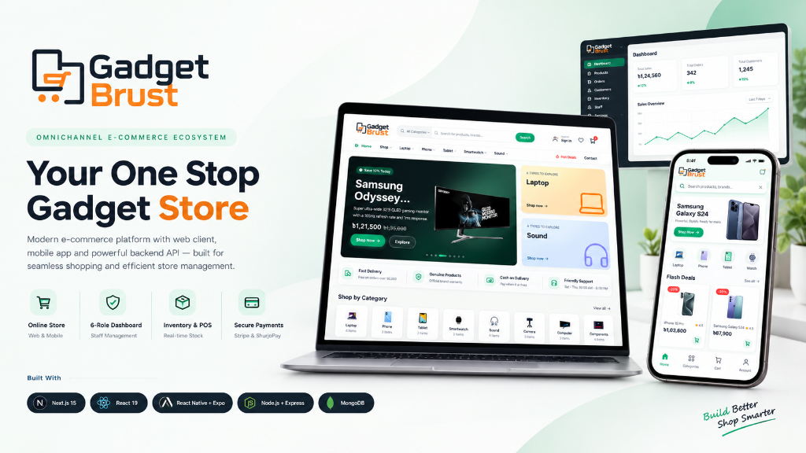

# 🛒 Gadget Brust — Web Client

[](https://gadgetbrust.vercel.app/)
[](https://gadgetbrust-server.vercel.app/api/health)
[](https://github.com/parvejme24/gadget-brust-server)

[](https://nextjs.org/)
[](https://react.dev/)
[](https://tailwindcss.com/)
[](https://tanstack.com/query)
[](https://redux-toolkit.js.org/)
[](https://www.radix-ui.com/)

<p align="center">
  
</p>

---

## 📌 Short Description

**Gadget Brust Web Client** is an enterprise-grade, high-performance e-commerce web application and multi-role operations portal. Engineered with **Next.js 15 (App Router)** and **React 19**, it bridges public consumer shopping—featuring guest checkout, instant order tracking, and synchronized carts—with a unified administrative command center supporting six distinct staff and managerial roles.

---

## ✨ Key Features

### 🛍️ Customer Experience & Storefront
- **Modern Catalog Browsing:** Instant product search, multi-faceted filtering (brand, category, price range, stock availability), and responsive product carousels.
- **Frictionless Guest Checkout:** Purchase gadgets instantly without forced account registration; complete delivery addresses and place orders in seconds.
- **Real-Time Order Tracking:** Track shipment status and delivery timelines by order ID and phone number.
- **Cross-Device Persistent Cart & Wishlist:** LocalStorage cart for visitors that automatically merges into the user account upon authentication.
- **Interactive Ratings & Reviews:** Verified purchase feedback system with star ratings and detailed customer reviews.

### 🏢 Unified Multi-Role Staff Dashboard
One comprehensive dashboard URL dynamically adapts navigation, controls, and data visibility based on user role:
- 👑 **Admin:** Complete system oversight, staff onboarding, role assignment, and store configuration.
- 🧭 **Manager:** Daily operations, sales audits, stock approvals, and employee performance tracking.
- 📦 **Store Keeper:** Catalog management, inventory replenishment, SKU adjustments, and audited stock logs.
- 🧾 **Cashier (Point of Sale - POS):** Fast in-store barcode/product lookup, live cart calculation, coupon validation, and instant thermal memo/invoice generation via jsPDF.
- 📣 **Marketing:** Promotional campaigns, discount voucher creation, customer engagement metrics, and sales reporting.
- 🛍️ **Customer Portal:** Order history, tracking links, profile management, and saved shipping destinations.

### ⚡ Architectural & Security Highlights
- **Server-Authoritative Pricing:** The frontend delegates all price calculations, discount vouchers, and tax evaluations to the API to eliminate client-side tampering.
- **Silent JWT Refresh:** Axios interceptors seamlessly handle token rotation using access and refresh tokens without interrupting user workflows.
- **Responsive & Accessible Design:** Fully fluid layout from 320px mobile displays to ultrawide desktop monitors with keyboard accessibility, Radix UI primitives, and reduced-motion support.

---

## 🛠️ Tech Stack

| Category | Technology | Description |
|---|---|---|
| **Framework** | Next.js 15 (App Router) | Server-Side Rendering (SSR), React Server Components, and Turbopack |
| **UI Library** | React 19 | Declarative UI component composition and hooks |
| **Styling** | Tailwind CSS 4 & PostCSS | Utility-first styling with modern CSS variables |
| **Components** | Radix UI Primitives | Unstyled, accessible UI foundations (dialogs, dropdowns, popovers) |
| **Server State** | TanStack Query v5 | Efficient data caching, background revalidation, and optimistic updates |
| **Client State** | Redux Toolkit | Predictable state container for sessions, cart, and wishlist |
| **Forms & Validation** | React Hook Form & Zod | Type-safe schema validation and performant form handling |
| **Visualizations** | Chart.js & React-Chartjs-2 | Interactive sales, revenue, and inventory analytics charts |
| **Document Generation** | jsPDF & jsPDF-AutoTable | Client-side dynamic PDF invoice and POS receipt printing |
| **Notifications** | Sonner & SweetAlert2 | Polished toast alerts and modal confirmation dialogs |
| **Icons & Media** | Lucide React & Swiper | Crisp icon library and responsive touch carousels |

---

## 💡 Why This Project?

Most e-commerce starter kits only address one half of the business: they provide a flashy customer-facing storefront while neglecting the messy, complex operational needs of real-world retail businesses.

Physical gadget shops frequently operate under chaotic hybrid conditions:
1. Online orders come in through web channels.
2. In-store walk-in customers buy at the physical checkout counter.
3. Inventory changes hands across warehouse staff, cashiers, and couriers.

**Gadget Brust Web Client was created to solve this divide.** It eliminates the need for merchants to purchase and maintain separate software subscriptions for their web storefront, in-store Point of Sale (POS), warehouse inventory management, and courier dispatch. Everything runs seamlessly in a single, unified web application.

---

## 🎯 Which Problems Solved?

1. **Fragmented Retail Software:** Replaces disconnected billing systems, inventory spreadsheets, and e-commerce platforms with a single web solution.
2. **Client-Side Security Flaws:** Traditional cart systems that compute totals on the client can be manipulated; this client validates every transaction strictly against server-calculated totals.
3. **Cart Abandonment via Friction:** Eliminates compulsory signup barriers by enabling full guest shopping, address auto-fill, and instantaneous order tracking.
4. **Staff Permission Chaos:** Prevents unauthorized operational accidents by enforcing strict RBAC—cashiers cannot alter product prices, marketing cannot alter database settings, and store keepers cannot delete order histories.
5. **Slow Data Re-fetching:** TanStack Query intelligently caches catalog and dashboard responses, slashing redundant network round-trips and delivering instantaneous page transitions.

---

## 🚀 Getting Started

### Prerequisites
- **Node.js** v18.17.0 or higher
- **npm** or **yarn** / **pnpm**
- Running instance of [Gadget Brust Server](https://github.com/parvejme24/gadget-brust-server)

### 1. Installation
```bash
# Clone the repository
git clone https://github.com/parvejme24/gadget-brust.git
cd gadget-brust/gadget-brust-client

# Install dependencies
npm install
```

### 2. Environment Configuration
Create a `.env.local` file in the root directory:
```env
NEXT_PUBLIC_API_URL=http://localhost:6060/api/v1
NEXT_PUBLIC_APP_NAME="Gadget Brust"
```

### 3. Run Development Server
```bash
npm run dev
```
Open [http://localhost:3000](http://localhost:3000) with your browser to see the result.

### 4. Build for Production
```bash
npm run build
npm run start
```

---

## 🏁 Conclusion

The **Gadget Brust Web Client** demonstrates how modern web engineering can unify consumer-facing design with robust enterprise operations. By pairing Next.js 15 and React 19 with a bulletproof role-based architecture, it delivers a lightning-fast shopping experience for customers and an organized command center for retail teams.

- 📱 **Looking for the mobile app?** Check out [Gadget Brust App](../gadget-brust-app).
- ⚙️ **Looking for the backend API?** Check out [Gadget Brust Server](../gadget-brust-server).
