<div align="center">


### A full-stack gadget store with one dashboard for six roles

Storefront, guest checkout, order tracking, point of sale, inventory, couriers and reports.<br/>
Built with Next.js 15, React 19, TanStack Query and Redux Toolkit, on a tested Express + MongoDB API.

[](https://gadget-hub-client-parvejme24s-projects.vercel.app)
[](https://gadgetbrust-server.vercel.app/api/health)
[](https://github.com/parvejme24/gadget-brust-server)


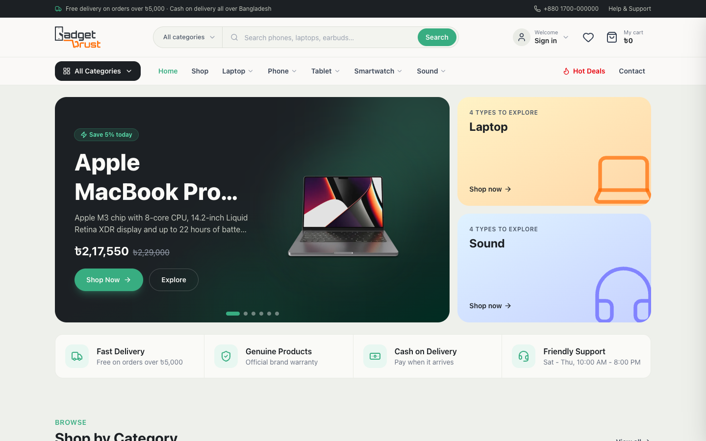

</div>

---

## Try it in one click

The login page has **one-tap demo buttons** for every role. Or sign in with these accounts:

| Role | Email | Password | What they see |
| --- | --- | --- | --- |
| 👑 Admin | `admin@gadgetbrust.com` | `Admin@123` | Everything, including staff and store settings |
| 🧭 Manager | `manager@gadgetbrust.com` | `Manager@123` | Day-to-day operations, without staff and settings |
| 📦 Store keeper | `store@gadgetbrust.com` | `Store@123` | Products, stock, categories, brands, reviews |
| 🧾 Cashier | `cashier@gadgetbrust.com` | `Cashier@123` | Point of sale, orders, customers, couriers |
| 📣 Marketing | `marketing@gadgetbrust.com` | `Marketing@123` | Coupons, reports, reviews, catalog |
| 🛍️ Customer | `rahim@example.com` | `User@123` | My orders, tracking, wishlist, reviews, addresses |

Guests can shop, check out and track orders without an account.

---

## Highlights

- 🛒 **Complete shopping flow**: browse, filter, search, add to cart, check out, then track the order by number and phone. No account required
- 👥 **Role-based dashboard**: one dashboard, six roles, each seeing only its own pages, shortcuts, search results and notifications
- 🧾 **Real store operations**: point-of-sale counter with printable memo, inventory with an audited stock log, courier shipping with tracking links, and order editing that recalculates totals and stock
- 💸 **Prices always come from the server**: checkout, coupons and POS are priced by the API, never by the browser
- 🔄 **Cart and wishlist follow you**: they work for guests in the browser and merge into your account when you sign in, so your phone and laptop stay in sync
- 🔐 **Secure sessions**: JWT access plus refresh tokens with silent refresh. Logout revokes the session on the server. Email-code password reset
- ✨ **Polished UI**: responsive from 320 px phones to wide screens, scroll animations that respect *reduce motion*, keyboard-friendly dropdowns and dialogs, skeleton loading states
- ✅ **Tested backend**: the API has 131 automated tests, including a check of every protected route for every role

---

## Screenshots

### Storefront

| Product catalog | Product details |
| :---: | :---: |
| 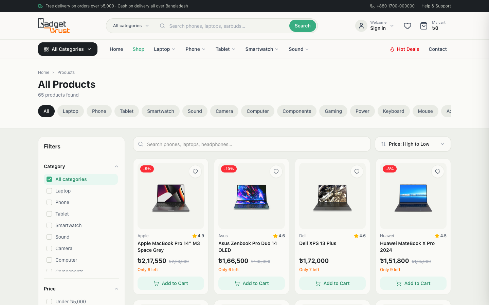 | 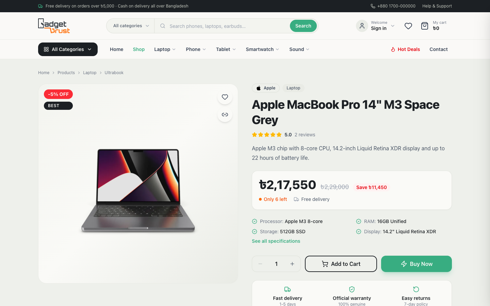 |
| URL-driven filters, sorting, live search, pagination | Buy box, specs, reviews, delivery estimate |

### Dashboard

| Admin overview | Point of sale (cashier) |
| :---: | :---: |
| 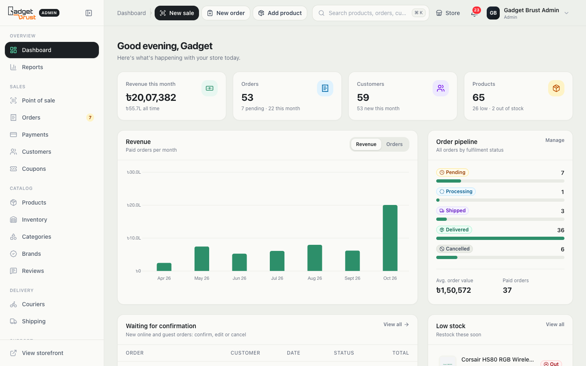 | 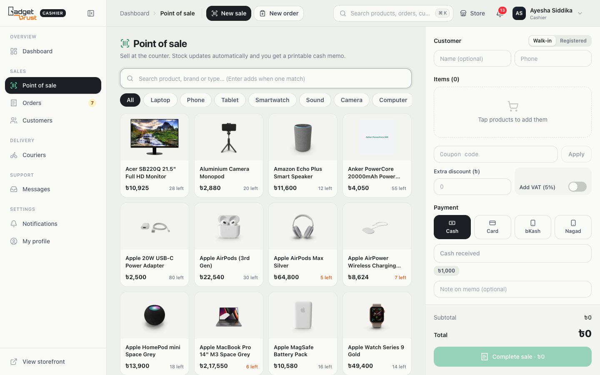 |
| KPIs, revenue chart, order pipeline, low stock | Counter sales: stock updates instantly, printable memo |

| Product management | Customer dashboard |
| :---: | :---: |
| 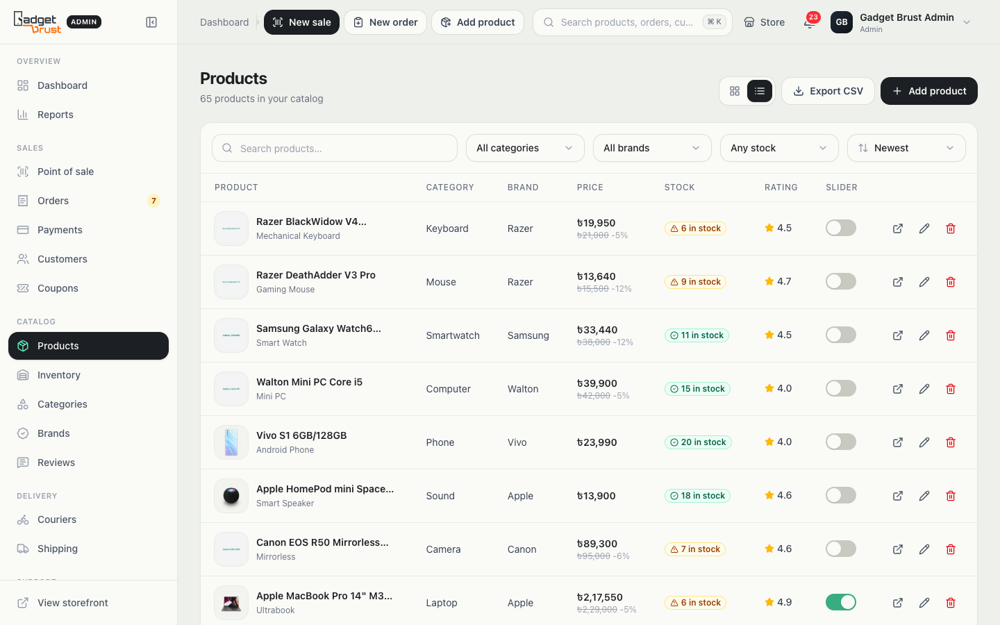 | 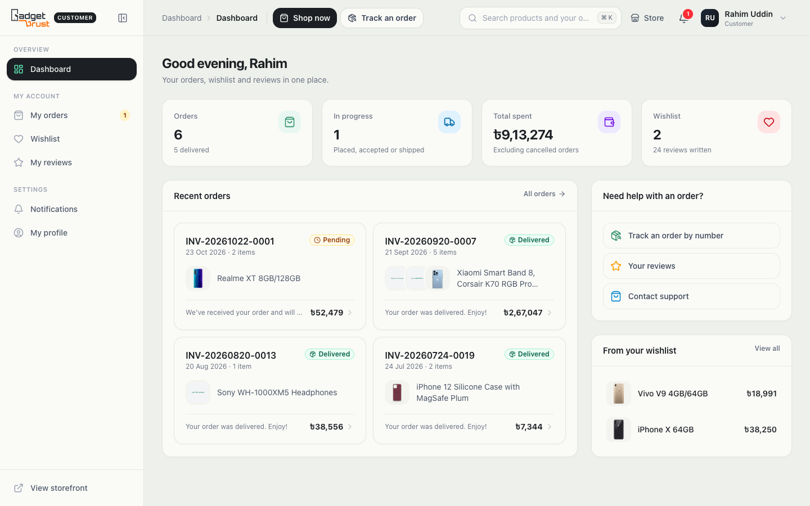 |
| Filters, CSV export, grid/table view, slider toggle | Orders, tracking, wishlist and reviews in one place |

### On mobile

<p align="center">
  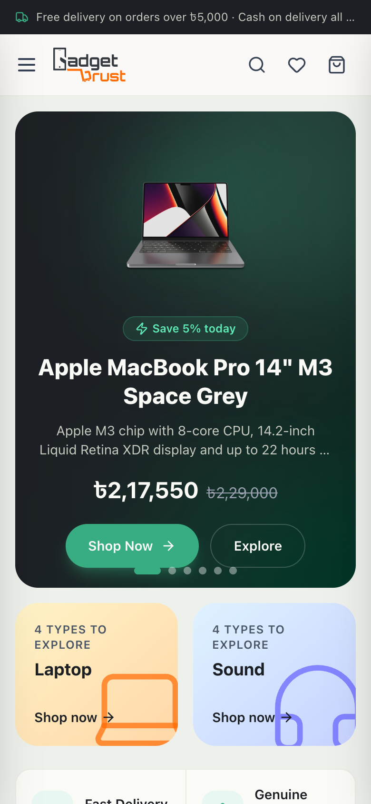
  &nbsp;
  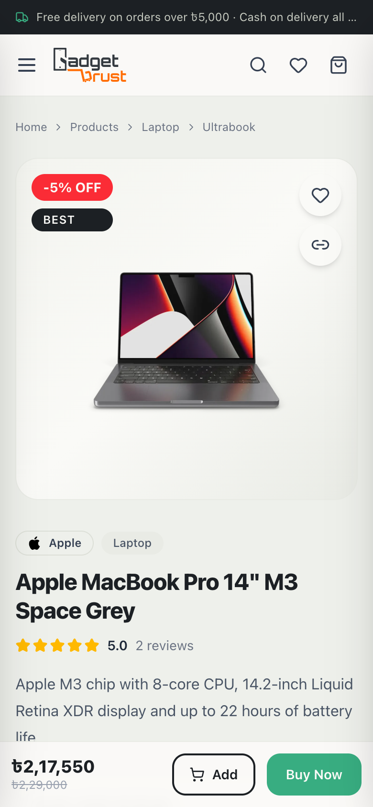
  &nbsp;
  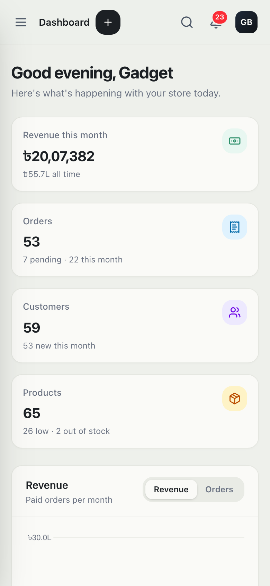
</p>

<details>
<summary><b>Sign-in page</b></summary>
<br/>
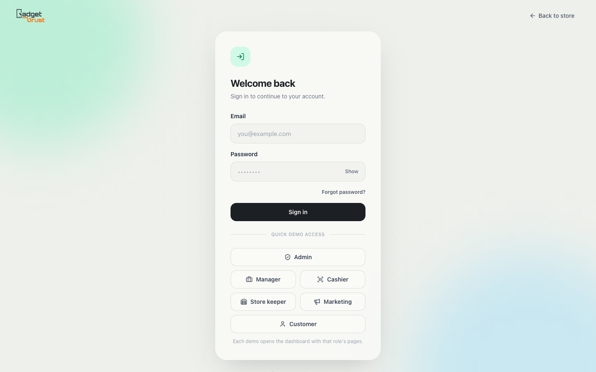
</details>

---

## Features

<details open>
<summary><b>🛍️ Storefront (guests and customers)</b></summary>

- Home page: hero slider of live deals, shop by category, flash deals with countdown, live coupon offers, brand marquee
- Mega menu built from real categories and brands; live search suggestions scoped by category
- Catalog filters for category, brand, price, stock and rating, all kept in the URL so results can be shared
- Product page: highlights, full specifications, verified reviews, delivery options, sticky mobile buy bar
- Cart, wishlist and mini-cart that work without signing in
- Checkout as a guest or a customer: saved addresses, coupon codes, delivery options, cash on delivery
- Public order tracking with a status timeline and courier tracking link
- Contact form that goes straight to the staff inbox
- Password reset with a 6-digit email code
</details>

<details>
<summary><b>📊 Staff dashboard</b></summary>

- **Overview** for each role, with its own KPIs, shortcuts and lists
- **Orders**: status tabs, filters, date ranges and CSV export. Accept, ship with a courier, deliver or cancel; stock and payments follow each step
- **Phone orders**: staff enter orders taken by phone or WhatsApp, priced by the server
- **Point of sale**: quick search (Enter adds a single match), category chips, walk-in or registered customers, coupons, VAT, change calculation, printable memo
- **Inventory**: restock, damage, returns and stock counts, all logged; low-stock alerts
- **Catalog**: products, categories, subcategories and brands, with image upload and key features
- **Couriers and shipping**: delivery partners, rates, COD fees, tracking link templates, delivery zones
- **Coupons**: percentage, fixed, buy-X-get-Y and free shipping, with limits and targeting
- **Payments and reports**: revenue charts, payment-method mix, top products, categories and customers; print and CSV
- **Messages**: contact inbox with unread/replied/archived tabs and reply by email
- **Staff and roles**: add staff, change roles, deactivate accounts (admin)
- **Store settings**: business details, delivery charges, tax, socials, SEO, announcement bar (admin)
- **Notifications**: per role and per user, unread badge, mark as read
- **Global search** (`Ctrl/⌘ K`): pages, products, orders, customers and coupons, limited to what the role may see
</details>

<details>
<summary><b>👤 Customer account</b></summary>

- Order history with a status timeline and courier tracking
- Saved delivery addresses with a default, used at checkout
- Wishlist, plus editable reviews
- Profile and password
</details>

---

## Tech stack

| Area | Tools |
| --- | --- |
| Framework | **Next.js 15** (App Router), **React 19** |
| Styling | **Tailwind CSS 4**, Radix UI primitives, shadcn-style components, lucide icons |
| Server state | **TanStack Query** for caching, background refetching and mutations |
| Client state | **Redux Toolkit**: session, browser cart and wishlist |
| Data and forms | Axios with automatic token refresh, React Hook Form, Zod |
| Charts and PDFs | Chart.js, jsPDF (POS cash memos) |
| UX | Sonner toasts, react-day-picker date ranges, Swiper, custom scroll-reveal animations |
| Backend | [gadget-brust-server](https://github.com/parvejme24/gadget-brust-server): Express, MongoDB/Mongoose, JWT, Cloudinary, Node test runner |
| Hosting | Vercel (frontend and API), MongoDB Atlas |

---

## Architecture

```
app/
├─ (WithCommonLayout)/      storefront: home, products, cart, checkout, tracking, contact
├─ (WithDashboardLayout)/   /dashboard/*: one dashboard, filtered by role
├─ login · register · forgot-password
components/
├─ Module/                  storefront features (Products, Checkout, Contact, Auth, …)
├─ Dashboard/               dashboard features (Orders, Pos, Inventory, Overview, …)
│  ├─ Layout/               shell, role-aware sidebar, top bar, notifications
│  └─ Kit/                  shared dashboard UI: panels, tables, modals, badges
└─ ui/                      design-system primitives (dropdowns, calendar, …)
lib/
├─ api.js                   one Axios client with token refresh
├─ services/                API calls per area (storefront, account, admin, checkout, session)
├─ hooks/                   TanStack Query hooks
├─ store/                   Redux slices (auth, shop)
├─ providers/               query client, store hydration, cart/wishlist sync
└─ permissions.js           role → permission table shared with the API
```

**How the data flows**
- Pages call hooks in `lib/hooks` → hooks use `lib/services` → services use the shared Axios client
- Server data is cached by TanStack Query and cleared on sign-in/out. Redux holds only the session and the browser cart/wishlist
- Access is enforced twice: the sidebar and pages check `lib/permissions.js`, and the API checks the same table on every request

---

## Run it locally

```bash
git clone https://github.com/parvejme24/gadget-brust-client.git
cd gadget-brust-client
npm install
npm run dev            # http://localhost:3000
```

It uses the live API by default. To use your own copy of [the backend](https://github.com/parvejme24/gadget-brust-server), create `.env.local`:

```env
NEXT_PUBLIC_API_URL=http://localhost:6060/api
```

| Script | What it does |
| --- | --- |
| `npm run dev` | Development server with Turbopack |
| `npm run build` | Production build |
| `npm start` | Serve the production build |

---

## Related projects

| Project | Description |
| --- | --- |
| [gadget-brust-server](https://github.com/parvejme24/gadget-brust-server) | REST API: Express, MongoDB, JWT auth, 131 automated tests |
| gadget-brust-app | Mobile app built with Expo / React Native |

---

<div align="center">

**Built by [Md Parvej](https://www.mdparvej.me)** · [GitHub](https://github.com/parvejme24)

If you like this project, a ⭐ on the repo is appreciated.

</div>
